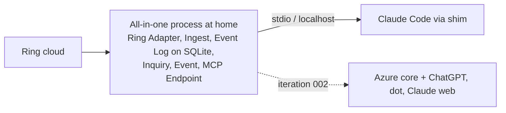
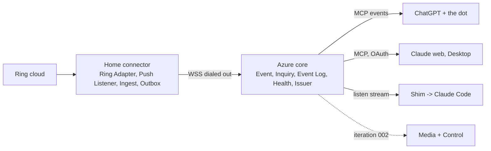
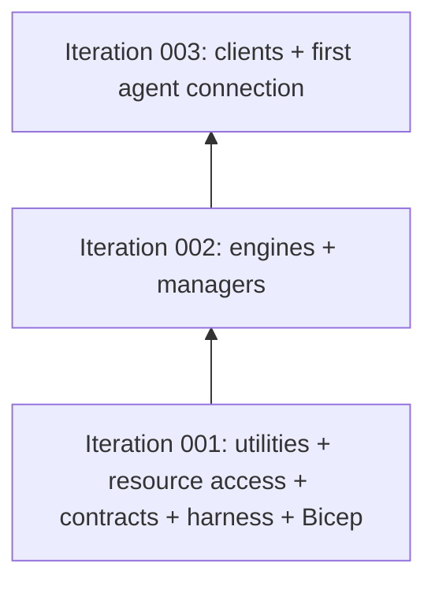

# Design Analysis — Feature 001-ring-mcp-bridge / Iteration 001

**Feature**: 001-ring-mcp-bridge
**Iteration**: 001
**Date**: 2026-11-01
**Spec**: file:///C:/Dev/RingMCPBridge/specs/001-ring-mcp-bridge/spec.md

<!--
  This artifact is the durable pre-plan design decision record. Plan generation is
  blocked until this file is valid AND the Human Decision section records a chosen
  option and commit hash.
-->

## Problem Framing

The bridge lets any MCP-capable agent know what is happening at a Ring home in real time and act within safe limits (spec Product Context). The spec is approved and clarified: 8 user stories, FR-001 to FR-048, SC-001 to SC-011. The author's own goal is to connect ChatGPT (including the dot) and Claude, which needs the hybrid deployment. The clarify session confirmed that other owners reach those agents the same way, and that all-in-one mode stays local-only.

The architecture is already decided and human-confirmed in the design workshop: IDesign decomposition, component map v3, the call rules, the seams, the contracts (component-design CD1-CD5), topology H plus mode A (architecture-core B3), TypeScript on Node with the I1-I8 implementation rules (code-implementation), Azure hosting with Bicep and GitHub Actions (devops-operations), and codex as the reviewer. None of the options below reopens any of that. What is still open is **how to slice v1 into iterations and what iteration 001 delivers**. That choice decides when cloud spend starts, when ChatGPT and the dot first connect, and how early the riskiest unknowns are tested:

- whether the unofficial Ring session survives 7 days for a non-US account (SC-003);
- whether ChatGPT's MCP events reach the agent and how the dot behaves on its schedule (integration-api S4, S7);
- whether sign-in through the bridge's own Issuer and Entra works with each target client (FR-029);
- whether a HIGH event reaches agents within 10 seconds end to end (SC-001).

## Key Design Decision Points

1. **The first slice's scope:** which user stories iteration 001 delivers, and which follow.
2. **The first slice's topology:** all-in-one only, or the real hybrid path (home connector, link, Azure core).
3. **When cloud spend starts:** about $23 a month for the hybrid resources (agent-derived from the devops-operations list prices, Israel Central, read 2026-10-26), under the $30 ceiling of SC-011.
4. **Risk order:** which of the four unknowns above iteration 001 tests first.
5. **Quality-profile reconciliation:** the quality resolver returned a generic profile and marked concurrency, resiliency and retry/idempotency as not applicable. The spec needs all three (see Applicable Lenses and the drift log). Every option carries the same correction.

Spikes S1 (official Ring API proof of concept) and S2 (one Ring request from the cloud) still wait for the owner's go. They do not change any option. If approved, either one fits alongside iteration 001.

## Alternatives

### Option A: Simplest — all-in-one first, hybrid in iteration 002

**Approach**: Iteration 001 builds US1 (state) and US2 (events) in all-in-one mode only: one Node process at home with the Ring Adapter, Push Listener, Ingest and Normalize, the event log and state on SQLite, the Inquiry and Event managers, the MCP Endpoint over stdio and localhost, and the channel shim for Claude Code. CI runs it against the scenario engine. No Azure resources, no Issuer or Entra sign-in, no link, no Bicep. Iteration 002 splits the same code into the hybrid wiring (Connector Link and Core Link, Azure SQL, the Issuer with Entra, Delivery to ChatGPT, Bicep and deploy). Media, control and the admin page follow after that.

**Architectural pattern**: IDesign map v3 (unchanged), wired by Host in mode A first.
**Quality features considered**: requirements-nfr (the 0.5 s in-bridge budget in CI; SC-003 soak at home), data-storage (SQLite only), observability (health tool only; no out-of-band alerts in mode A). Security, integration and devops are deferred to iteration 002.
**Effort estimate**: M for iteration 001 (about 20 of the map's components: the home side, the core managers and resource access for state and events, MCP Endpoint, the shim, the scenario engine).
**Reversibility cost**: Low. Mode A is a supported mode in v1 anyway, and hybrid adds wiring and resources to the same components.
**Trade-offs**:

- (+) $0 cloud spend during iteration 001; the Azure bill starts with iteration 002.
- (+) Fastest first user-visible value: Claude Code sees live events at home.
- (+) Starts the SC-003 Ring-session soak early, because the Ring session lives at home in both topologies.
- (−) ChatGPT, the dot and Claude on the web or phone cannot connect until iteration 002. That is the author's main goal.
- (−) The riskiest unknowns (OAuth with Entra per client, ChatGPT MCP events, the link, the 10-second end-to-end budget) are all tested one iteration later.
- (−) No out-of-band alert while only mode A exists (B12).

**Design principle / why this matters**: the cheapest route to running code. It defers the volatile, external hops instead of isolating them early, so the riskiest integration learning comes last.

**Recommended for**: an owner who wants local-only use first, or who wants no cloud bill until the core event model is proven.

**Diagram**:



### Option B: Reasonable — hybrid walking skeleton for state and events

**Approach**: Iteration 001 builds a thin but complete slice of US1 (overview, device list, one device, health) and US2 (HIGH and MEDIUM push, read from a cursor, late events, the recovery summary) on the real hybrid path:

- **Home connector:** Setup CLI (Ring login and 2FA by the owner, the connector key and enrollment code), Ring Adapter with the shared limiter and circuit, Push Listener, Ingest, Normalize and Outbox Store, Core Link, Home Scheduler (heartbeat, resends).
- **The link:** Link transport over WSS, dialed out from home, versioned hello.
- **Azure core:** Host (wiring, lease, `/livez`, `/readyz`), Connector Link, Event and Inquiry managers, Classify, Summary and Health engines, Event Log, State, Subscriptions, Audit chain and Settings on Azure SQL, Delivery to ChatGPT's MCP events, listen streams and the channel shim.
- **Agent access:** MCP Endpoint for both protocol eras, with the Issuer and your Entra sign-in, and the read scope only.
- **Owner:** a minimal admin page (health and enrollment code compare). Out-of-band heartbeat and home-offline alerts.
- **Delivery:** Bicep and the GitHub Actions deploy. CI runs against the scenario engine and the second oidc-provider standing in for Entra.

Mode A comes along for development and CI, because Host wires A or H from the same components. Iteration 002 adds media (US3) and safe control (US4). Iteration 003 adds the rest of the owner's admin page (US6), disarm switched off (US5), the open-source README for both modes (US7) and shared locations (US8).

**Architectural pattern**: IDesign map v3 (unchanged) as a walking skeleton: every layer and both sides of the link exist from iteration 001, each holding only what state and events need.
**Quality features considered**: all nine lenses (see Applicable Lenses). Security, integration and devops are exercised in iteration 001 instead of deferred.
**Effort estimate**: L for iteration 001 (about 32 of the map's components, with a thin slice of each). Iterations 002 and 003 are then M each, because they widen existing components rather than add infrastructure.
**Reversibility cost**: Medium. The skeleton commits the Azure resources and the link protocol early. Both are already decided bindings, so the risk is being early, not being wrong.
**Trade-offs**:

- (+) ChatGPT, the dot and Claude can read the home and receive pushed events at the end of iteration 001.
- (+) All four unknowns are tested first: the 10-second end-to-end budget (SC-001) is measured on the real hops, Entra sign-in is proven per client, ChatGPT events and the dot are tried, and the SC-003 soak starts.
- (+) The bill is measured from the first iteration, so SC-011's ceiling is checked early.
- (+) Both query-layer dialects (SQLite and T-SQL) run from the start, so CD4's per-component DTO rule and the dependency check are proven on the real layout.
- (−) Cloud spend starts in iteration 001: about $23 a month (agent-derived: App Service B1 $14.45, SQL Basic $6.46, alerts $1.50, Blob and Key Vault under $1).
- (−) The largest first iteration. More codex review runs on your own plan, and more GitHub Actions minutes. CI minutes are assumed free while the repository is public (devops-operations); a private repository uses the plan's minutes.
- (−) Media and control, the parts users notice most after events, arrive one iteration later than in a story-by-story order.

**Design principle / why this matters**: reduce the riskiest uncertainty first. A walking skeleton proves every hop and the deployment path while the code is still small, so a surprise in Ring's session, ChatGPT's events or the sign-in changes a thin slice, not finished features.

**Recommended for**: this feature. The author's goal needs hybrid, and the unknowns sit on the hybrid path.

**Diagram**:



### Option C: By-the-book — foundation first, layer by layer

**Approach**: Iteration 001 builds the foundations for both modes and every story before any agent-visible tool: all utilities (Security, Logging, Pub/Sub, Config, Clock, Link transport, Query layer for both dialects), every resource-access component (State, Event Log, Subscriptions, Delivery, Media Cache, Audit with WORM shipping, Command, Settings, Grants, Lease, Secrets), the Public Contract schemas and their snapshot test, the full test harness (scenario engine with fault injection, the second oidc-provider for Entra, the CI dependency check), and the whole Bicep template. Iteration 002 adds the engines and managers. Iteration 003 adds the clients (MCP Endpoint, Issuer, Web, Connector Link, Scheduler) and the first agent connection.

**Architectural pattern**: IDesign map v3 (unchanged), built bottom-up by layer.
**Quality features considered**: all nine lenses in depth at the resource layer; nothing is exercised end to end until iteration 003.
**Effort estimate**: L for iteration 001 and L for iteration 002, with no user-visible value until iteration 003.
**Reversibility cost**: High. Everything below the managers is fixed before any real traffic tests it, so a surprise at the edges (Ring payloads, ChatGPT events, client sign-in) means reworking finished lower layers.
**Trade-offs**:

- (+) Each lower layer is complete and fully tested before anything depends on it.
- (+) The contracts are stable early.
- (−) No agent connects until iteration 003. ChatGPT and the dot come last.
- (−) The four unknowns are tested last, when the most code depends on the assumptions.
- (−) If the Azure resources are deployed in iteration 001, the bill (about $23 a month, agent-derived) runs for two iterations with no user value.

**Design principle / why this matters**: textbook layering gives clean, complete layers, but it front-loads the parts least likely to surprise us and back-loads the volatile edges. That is premature completeness for a bridge whose main risk is external behaviour.

**Recommended for**: a system whose integrations are already proven and whose risk is internal complexity. That is not this feature.

**Diagram**:



## Applicable Lenses

Selected by the applicability questionnaire (recorded in `lens-applicability.json`). The answers mirror the feature-level selection the human confirmed in the design workshop (all lenses closed, human-confirmed). This is not a new confirmation.

- **architecture-core** - `extensions/specrew-speckit/knowledge/design-lenses/architecture-core.md`
  - Decision points: design method; building blocks; volatile areas; binding constraints; out of scope this iteration; the best balance of simplicity, reversibility and future cost.
  - Addressed: every option keeps the bound IDesign map v3 and topology H plus mode A. The comparison is on the last decision point. See Option A's and Option C's Reversibility cost and the Option B principle (isolate the volatile external hops first). The out-of-scope split per iteration is in each Approach.
- **component-design** - `extensions/specrew-speckit/knowledge/design-lenses/component-design.md`
  - Decision points: responsibilities; dependency direction; abstractions; schema decoupling; extension mechanism.
  - Addressed: the options differ in which components exist first. Option B's Trade-offs: both query-layer dialects and the CD4 per-component DTO rule are proven on the real layout in iteration 001. Option C's Trade-offs: contracts stable early but untested by traffic. Option A's Approach: the CD3 seams for Ring Access and Delivery stay in-process until iteration 002.
- **requirements-nfr** - `extensions/specrew-speckit/knowledge/design-lenses/requirements-nfr.md`
  - Decision points: NFR design drivers; mandatory constraints; measurable thresholds; unknowns; acceptance criteria that prove quality.
  - Addressed: SC-001 (10 seconds end to end) and SC-003 (7-day session) are the drivers. Option B's Trade-offs: SC-001 is measured on the real hops in iteration 001. Option A's Trade-offs: only the 0.5 s in-bridge budget early. Option C's Trade-offs: both late. SC-011 (the $30 ceiling) is in every option's cost line.
- **ui-ux** - `extensions/specrew-speckit/knowledge/design-lenses/ui-ux.md`
  - Decision points: source of UX truth; journeys; data operations; states; UI state; accessibility and theming.
  - Addressed: the agreed layout (Co-Design Record) does not change. The options differ in when pages ship. Option B's Approach: a minimal admin page (health and enrollment compare) in iteration 001, the full page in iteration 003. Option A: no page until iteration 002. Option C: pages last.
- **security-compliance** - `extensions/specrew-speckit/knowledge/design-lenses/security-compliance.md`
  - Decision points: identity; authorization model; sensitive data; audit; threat surfaces.
  - Addressed: Option B's Approach and Trade-offs: the Issuer, Entra sign-in, the read scope, the audit chain and the connector's enrollment are exercised in iteration 001, with control scope deferred with control. Option A's Trade-offs: OAuth and enrollment are deferred, and mode A's local-only trust model is the only one tested. Option C: built but not exercised by a real client until iteration 003.
- **data-storage** - `extensions/specrew-speckit/knowledge/design-lenses/data-storage.md`
  - Decision points: persistence; ownership; storage model; consistency; migrations and retention; no shared private databases.
  - Addressed: Option B's Trade-offs: SQLite at home (outbox) and Azure SQL in the core both run in iteration 001, including the one-transaction event write (Event Log + State + Audit). Option A's Approach: SQLite only. Option C's Approach: every store first, retention and WORM included, with no real data flowing.
- **integration-api** - `extensions/specrew-speckit/knowledge/design-lenses/integration-api.md`
  - Decision points: integration style; contract ownership and versioning; sync or async; idempotency; auth and throttling; compatibility testing.
  - Addressed: Option B's Trade-offs: ChatGPT MCP events, both MCP eras, the link's N and N-1 hello and the Ring limiter are exercised in iteration 001. Option A's Trade-offs: only Claude Code over stdio and localhost. Option C's Trade-offs: the contracts are fixed before any external call proves them.
- **devops-operations** - `extensions/specrew-speckit/knowledge/design-lenses/devops-operations.md`
  - Decision points: hosting model; infrastructure as code; environments; secrets and configuration; CI/CD; CI lane for this forge (GitHub Actions; the repository is on GitHub); identities.
  - Addressed: Option B's Approach and Trade-offs: Bicep, the GitHub Actions deploy and managed identities in iteration 001, with the bill starting then (about $23 a month, agent-derived). Option A's Trade-offs: $0 cloud and no deploy path until iteration 002. Option C's Trade-offs: the bill may run two iterations without user value.
- **observability-resilience** - `extensions/specrew-speckit/knowledge/design-lenses/observability-resilience.md`
  - Decision points: logging and metrics; correlation; health checks; expected errors; retry, timeout, idempotency and circuit; cost of observability.
  - Addressed: Option B's Approach: health, `/livez` and `/readyz`, the out-of-band heartbeat and home-offline alerts, reconnect with backoff, outbox resend, catch-up and the Ring circuit are all in iteration 001. Option A's Trade-offs: no out-of-band alert (B12). Option C: built without real failures to observe. In every option, the quality-profile correction re-adds concurrency, resiliency and retry/idempotency as required.

## Co-Design Record

**Human-agreed**: yes. This baseline was co-designed with the human in the component-design lens. CD1 (the map) was answered "Agree" on 2026-10-28, and the lens closed with "move on" on 2026-10-29. Code-implementation I4 later amended it, human-confirmed on 2026-10-30 (the scenario engine and the second oidc-provider for tests, no map change). No component was added or removed after map v3. This design analysis does not change it. The human's verdict on this design analysis confirms it as the baseline for iteration 001, and any change to it is given as `approved for plan with Option <X> - <changes>`.

**The agreed component map (map v3, as decided):**

```text
 COMPONENT MAP v3 (IDesign; calls go only downward). Each component exports its own
 DTOs from its entry file; there is no shared types file (CD4).

 AGENTS: ChatGPT + dot, Claude surfaces   CHANNEL SHIM (your PC)   YOU (phone or PC)
            | HTTPS, our tokens                  | HTTPS                  | HTTPS
 ===========v============= AZURE CORE (one instance, B7) v========================v=====
 CLIENTS    [MCP Endpoint]  [Issuer]  [Web: pages, clip links]  [Connector Link]
            [Scheduler]  [Host: wiring, lease, /livez, /readyz]
                 |  clients call managers only
 MANAGERS   [Inquiry]   [Control]   [Media]   [Event]   [Admin]
                 |  a manager never calls a manager; queued calls go through Pub/Sub
 ENGINES    [Summary]   [Safety]    [Capture] [Classify] [Health]
                 |  engines are rules only; managers call engines and resource access
 RESOURCE   [Ring Access] [State] [Event Log] [Subscriptions] [Delivery] [Media Cache]
 ACCESS     [Audit] [Command] [Settings] [Grants] [Lease] [Secrets]
                 |
 RESOURCES  home link   Azure SQL   Blob (media, WORM)   Key Vault   agents' push
            endpoints   Entra ID (your sign-in)
 UTILITIES  Security | Logging | Pub/Sub | Config | Clock | Link transport
            | Query layer   (any layer may call a utility)
 SCHEMAS    [Public Contract]: the tool schemas and event shape agents see; no logic;
            imported only by MCP Endpoint and Delivery; published as JSON Schema
 =======================================^===============================================
                                        | WSS, dialed out from home (no open ports)
 ====================== HOME CONNECTOR (Docker on the Ubuntu VM) ========================
 CLIENTS    [Setup CLI]   [Core Link]   [Push Listener]   [Home Scheduler]
 MANAGERS   [Execute]: commands, captures, auto-off    [Ingest]: events, outbox, catch-up
 ENGINES    [Normalize]: Ring payloads -> the bridge's event shape
 RESOURCE   [Ring Adapter]: limiter, circuit   [Live Media]   [Outbox Store]
 ACCESS     [Secrets File]
 RESOURCES  Ring cloud (REST, alarm websocket, push, live view)   SQLite   encrypted file
 Mode A (all at home): the same components in one process; Ring Access calls Execute
 directly, and the link, Connector Link and Core Link are not used.
```

**Every component and its responsibility (IDesign vocabulary):**

Clients (core):

- **MCP Endpoint** — the MCP server for both protocol eras; checks token and scopes; one tool call becomes one manager call; maps manager DTOs into the Public Contract.
- **Issuer** — the OAuth server (oidc-provider): listed agents link, the owner signs in with Entra, it issues, refreshes and revokes tokens; calls Grants directly (X1).
- **Web** — the admin page, the confirm page, authenticated clip links.
- **Connector Link** — events and heartbeats from home, queued to Event; checks the connector's signed hello; declares EventMessage (N and N-1) with the catch-up-done marker.
- **Scheduler** — minute ticks for the home-offline check, purges, the battery digest, token expiry and WORM shipping; a daily tick for the 90-day signing-key rotation.
- **Host** — wires mode H or A; owns the Link transport; holds the single-instance lease; `/livez` and `/readyz`.
- **Channel shim** (outside the core, on the owner's PC) — relays push to Claude Code.

Managers (core):

- **Inquiry** — every read tool, plus get_events with the last-read fallback.
- **Control** — arm Home and Away, lights with auto-off, disarm; prepare then confirm, at most once, lease checked.
- **Media** — frame, burst and clip, including the frame taken after an event.
- **Event** — saves each event in one transaction, sets its priority, sends it to every agent; health changes and push filters; late events stored, one recovery summary pushed.
- **Admin** — the owner's admin-page tasks: agents and revoke, enrollment, switches, owners' agreements, the PIN change, signing-key rotation, delete now, the audit view, the Issuer's policy, WORM shipping and the chain check.

Engines (core):

- **Summary** — replies sized to a token budget.
- **Safety** — one-time tokens, the disarm gate, the PIN tries and lock, the fresh sign-in check.
- **Capture** — picks snapshot, live frame or cached copy; the battery cap.
- **Classify** — priority, motion opt-ins, the battery threshold, the late-event rule.
- **Health** — one health view from the heartbeat, last event, database, lease and WORM lag.

Resource access (core):

- **Ring Access** — the only way to Ring: over the link (H) or in-process (A); later the official adapter; fails in-flight commands on a link drop.
- **State** — locations, devices, alarm state, health snapshot, each with `as_of`.
- **Event Log** — events by sequence, the epoch, dedupe.
- **Subscriptions** — cursors, push filters, the per-client last-read mark.
- **Delivery** — ChatGPT webhooks, listen streams, the channel shim; maps into the Public Contract's event shape.
- **Media Cache** — frames and clips in Blob (a folder in mode A), kept 7 days.
- **Audit** — the hash chain, the database copy, WORM shipping.
- **Command** — commands, used tokens, the pending disarm, the PIN tries and lock row.
- **Settings** — the owner's switches, listed agents, owners' agreements, the connector key.
- **Grants** — the Issuer's storage.
- **Lease** — the single-instance lease row.
- **Secrets** — Key Vault (the encrypted file in mode A); writes only the PIN hash and the signing keys.

Utilities and schemas (core):

- **Security**, **Logging**, **Pub/Sub**, **Clock** — shared cross-cutting utilities.
- **Config** — start-up settings only.
- **Link transport** — the WSS session both ends share; frame types, versions and priority; media in chunks behind commands, events and heartbeats.
- **Query layer** — SQLite and T-SQL.
- **Public Contract** — the tool schemas and event shape agents see; published as JSON Schema; imported only by MCP Endpoint and Delivery.

Home connector:

- **Setup CLI** — Ring login and 2FA by the owner; the connector key and enrollment code.
- **Core Link** — dials out, receives commands, sends events and the heartbeat; declares CommandMessage.
- **Push Listener** — Ring push into Ingest.
- **Home Scheduler** — the heartbeat, resends, due auto-off timers.
- **Ingest** (manager) — normalize, outbox, send; after a gap: drain the outbox, catch up from Ring history, mark late events, send one catch-up-done marker.
- **Execute** (manager) — runs each command once; captures; the auto-off timers.
- **Normalize** (engine) — Ring payloads into the bridge's event shape; a tolerant reader (unknown kinds become `ring.other`); Ring strings marked untrusted.
- **Ring Adapter** — ring-client-api, the shared limiter, the circuit; the scenario engine stands in for it in CI.
- **Live Media** — frames, bursts and clips from live view; fixed test images stand in for it in CI.
- **Outbox Store** — SQLite with the outbox, executed command ids, timers, the catch-up mark.
- **Secrets File** — the Ring token, push credentials, device ID, connector key.

**Agreed flow (component-design key flow 1, a HIGH event), walked through the map:**

```text
 A contact sensor opens while the home is armed Away

 HOME   Ring push -> Push Listener -> Ingest -> Normalize -> Outbox Store (durable)
        -> Core Link ==WSS==>
 CORE   Connector Link -> Event (queued) -> Classify: contact while armed = HIGH
        -> ONE transaction: Event Log (dedupe on event_id, next seq) + State + Audit
        -> ack home (Outbox Store clears the row)
        -> Delivery: ChatGPT MCP events (and the dot on its next run, from its cursor),
           listen streams for Claude, the channel shim for Claude Code   (<= 0.5 s p95)
        An agent that missed the push reads get_events after its saved cursor
        (Inquiry -> Subscriptions + Event Log): nothing skipped, nothing twice.
```

**Agreed UI layout (ui-ux U1-U5, human-confirmed 2026-10-26):**

```text
 ADMIN PAGE (owner only, after a fresh sign-in; served by the core)
 +-------------+-----------------------------------------------------------------------+
 | Health      | HEALTH                                    as of 14:02:10   [Refresh]  |
 | Agents      |  Home link    OK     connected 3 days                                 |
 | Cameras     |  Ring         OK     session 6 days old                               |
 | Locations   |  Push         OK     last event 14:01:55                              |
 | Data        |  Database     OK     0.3 of 2 GB                                      |
 | Audit       |  Connector    v1.4   core is v1.5: pull the new image at home         |
 | Settings    | ! A banner when something is down: what it means, what to do next     |
 +-------------+-----------------------------------------------------------------------+

 CONFIRM PAGE (phone, from the agent's link; disarm only)
 +----------------------------------+
 | Signed in as you (fresh sign-in) |
 | ChatGPT (the dot) asks to:       |
 |   DISARM   Home                  |
 |   Monitoring: on                 |
 |   Expires in 1:42                |
 | PIN  [ ****** ]                  |
 | [ Cancel ]          [ Disarm ]   |
 +----------------------------------+

 ONE LAYOUT, THREE WIDTHS (dark by default, [Theme] switch remembered per browser):
 Fold folded = one column + menu button; Fold unfolded = side menu + content;
 PC = side menu + card grid + full-width tables. Status = word + icon, never colour alone.
```

## Crew Recommendation

**Recommended: Option B.**

The author's goal is ChatGPT (including the dot) and Claude acting on the home, and that only works through the hybrid path. Option B delivers it at the end of iteration 001 instead of iteration 002 (Option A) or 003 (Option C). It also answers decision point 4 in the right order. The four unknowns that could reshape v1 all sit on the hybrid path: Ring's session for a non-US account, ChatGPT's MCP events and the dot, Entra sign-in per client, and the 10-second end-to-end budget. A walking skeleton tests every one of them while the code is still a thin slice, so a surprise costs little.

The price is decision point 3. Cloud spend of about $23 a month (agent-derived) starts one iteration earlier than in Option A. It stays under the $30 ceiling, and measuring the real bill early is itself a check SC-011 needs. Option B is also the largest first iteration, which means more codex review runs and CI minutes at the start. Mode A is not lost: it is the same components wired by Host, so development and CI run on it from day one.

Option A is the right choice only if you want no cloud bill until the event model is proven locally, and you accept that ChatGPT and the dot wait an iteration. Option C front-loads the parts least likely to surprise us and is not recommended here.

## Human Decision

- **Decision verdict**: approved for plan with Option B (typed by the owner, 2026-11-02)
- **Chosen option**: Option B
- **Reason**: The owner accepted the crew recommendation; no further reason given.
- **Modifications**: None. Accepted with the verdict, as the stop stated: the DRIFT-001-01 correction. plan.md's quality section and `quality/hardening-gate.md` mark concurrency-correctness, resiliency, and retry-idempotency-and-recovery (and the "Retry and idempotency" focus area) as required, each with its FR reason. Spikes S1 and S2 and workshop question 16 still wait for the owner's separate go.
- **Design-analysis draft commit**: 87bc8ee
- **Decision recorded in commit**: b5522d8
