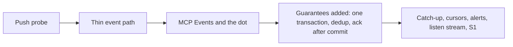
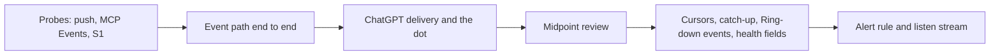
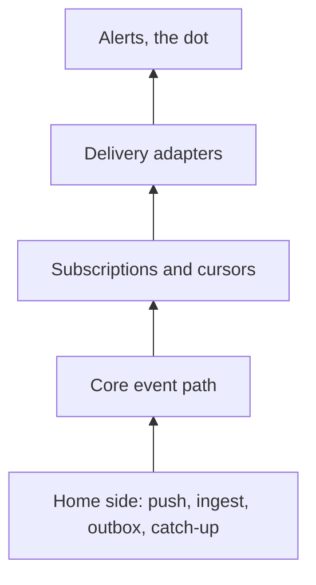

# Design Analysis — Feature 001-ring-mcp-bridge / Iteration 002

**Feature**: 001-ring-mcp-bridge
**Iteration**: 002
**Date**: 2026-11-17
**Spec**: file:///C:/Dev/RingMCPBridge/specs/001-ring-mcp-bridge/spec.md
**Status**: decided, Option B (the owner, 2026-11-17)

<!--
  This artifact is the durable pre-plan design decision record. Plan generation is
  blocked until this file is valid AND the Human Decision section records a chosen
  option and commit hash.
-->

## Problem Framing

Iteration 001 delivered the read path on the hybrid topology. The home connector holds the Ring session, the core in Azure serves the four read tools, and ChatGPT and Claude sign in through the bridge's Issuer and read the home. It closed on 2026-11-16 at about 75.75 SP of effort against a plan of 42 (estimate; iteration 001's retro).

Iteration 002 adds pushed events, as the feature plan forecast it (16 SP before calibration):

- Ring's push reaches the home connector, which normalizes events, catches up to 24 hours, and marks late events (CP-08b).
- The core classifies events, then writes the Event Log, State and Audit in one transaction. It gives a recovery summary and a Ring-down health event (CP-11b).
- Each client gets cursors with epochs and its own delivery state (CP-12).
- Delivery uses current-era MCP events (ChatGPT), earlier-era clients, the listen stream and the channel shim (CP-13).
- Out-of-band alerts cover heartbeat loss and the home offline (CP-18).
- Spike S1 asks whether a non-US account can register an official Ring private app (CP-20).
- The dot and the first end-to-end latency samples (CP-21b).

The architecture is already decided at the feature level: the component map, the contracts and the implementation rules. This design analysis decides how iteration 002 slices and orders that work, and what it takes from iteration 001's retro.

The unknowns it must face:

- whether ChatGPT's MCP events reach the agent, and how the dot behaves (integration-api S4, S7);
- whether a HIGH event reaches agents within 10 seconds end to end (SC-001);
- how reliable Ring's push reception is, starting from the push library's "crypto-key is missing" log line;
- whether a non-US Ring account can register an official private app (S1).

## Key Design Decision Points

1. **Capacity and calibration.** Decided; see Decisions So Far.
2. **Which design areas apply** (the design-analysis questionnaire).
3. **The slice and order of the event path.** Simplest to by-the-book options, as in iteration 001.
4. **Risk order** among the unknowns above.
5. **The carried items** from iteration 001's retro Signals, and which of them enter iteration 002's scope:
   - SC-003's soak (ending about 2026-11-21) and the clock check;
   - SC-011's bill;
   - DRIFT-001-77, the snooze;
   - DRIFT-001-89's known limit;
   - the agent reads on the new core.
6. **Task ids and the task ledger** (DRIFT-002-01): task ids that match tasks.md, or the ledger kept current as each task finishes.
7. **A midpoint independent review** (iteration 001's Lesson 6).

## Applicable Lenses

Selected by the questionnaire in file:///C:/Dev/RingMCPBridge/specs/001-ring-mcp-bridge/iterations/002/lens-applicability.json (the owner typed "confirm", 2026-11-17). Eight of nine areas apply.

| Lens | Why | Depth | What it decides for iteration 002 |
| --- | --- | --- | --- |
| architecture-core | always on | light | The event path fits the decided topology (home connector and Azure core, plus all-in-one mode) with no new deployable |
| component-design | always on | full | The event path's components and responsibilities, co-designed, with one flow walked: Ring push to connector, link, Event manager, event log, agent notification |
| requirements-nfr | always on | medium | The 10-second budget (SC-001), 24-hour catch-up, at-least-once delivery with dedup, and how each is measured |
| security-compliance | auth and secrets: yes | medium | Untrusted event text reaching agents, push credentials on the home, per-client subscriptions |
| data-storage | persistent data: yes | medium | The event log, cursors with epochs, each client's delivery state, retention, the one-transaction write |
| integration-api | external services: yes | full | Ring's push (the "crypto-key is missing" line), MCP events to ChatGPT, earlier-era clients, the listen stream, the channel shim, the dot |
| devops-operations | deploy and CI: yes | light | The out-of-band alert rule (about $1.50 a month, feature plan) and the new migrations |
| observability-resilience | performance and resilience: yes | medium | The Ring-down health event, push-reception health, the recovery summary, catch-up |
| ui-ux | user-facing UI: no | skipped | Iteration 002 builds no screen of its own. The dot is ChatGPT's indicator, and the admin page does not change unless a later decision says it should show push health |

How the options address each selected area:

- **architecture-core**
  - Addressed: every option keeps the decided topology and map with no new deployable. See each option's Architectural pattern; the options differ only in order (Option B's Approach).
- **component-design**
  - Addressed: the options differ in which components exist first. Option B's Approach builds each component once with its guarantees; Option A's Trade-offs name the rework; Option C's Approach builds by layer.
- **requirements-nfr**
  - Addressed: SC-001's 10-second budget is the driver. Option A's and Option B's Trade-offs: measured early on the real path. Option C's Trade-offs: proven last.
- **security-compliance**
  - Addressed: Option B's Quality features considered: the callback rules, untrusted marking and subscription secrets are built in with steps 2 and 3. Option A's Quality features considered: hardening follows the thin slice.
- **data-storage**
  - Addressed: Option B's Approach, step 2: the one-transaction write and dedup from the start. Option A's Trade-offs: added later on a path in use. Option C's Approach: the stores complete before delivery.
- **integration-api**
  - Addressed: Option B's Approach, step 1: the push probe, MCP Events on the owner's plan and Spike S1 run first, in parallel. Option A's Approach: push and MCP Events first, S1 last. Option C's Trade-offs: MCP Events and the dot last.
- **devops-operations**
  - Addressed: Option B's Approach, step 5, and Option C's Approach, step 5: the alert rule after the event path exists. The deploy is the same in every option.
- **observability-resilience**
  - Addressed: Option B's Approach, step 4: Ring-down events, the health fields, catch-up and the recovery summary. Option A's Approach, step 3: the same, after the thin slice.

The coding rules carry over from the feature's implementation rules; a new dependency would come up under integration-api. Codex reviewed rounds 1–3. On 2026-11-19 the owner assigned Claude to review subsequent work with Codex as developer.

## Decisions So Far

- **Capacity** (the owner, 2026-11-17, typed "1"):
  - Keep the capacity at 42 SP, and scale each task estimate by about 1.8, iteration 001's measured ratio of effort to plan (estimate).
  - Each estimate includes its co-review rounds and its first real-world run (iteration 001's Lesson 1).
  - At that ratio, the 16 SP forecast is about 29 SP of effort, leaving about 13 SP under the cap for the carried items (estimate).
- **Design areas** (the owner, 2026-11-17, typed "confirm"): the eight areas above, with ui-ux skipped.
- **architecture-core** (the owner, 2026-11-17, typed "Yes" and "move on"):
  - IDesign and the hybrid topology plus all-in-one mode stay. The channel shim on the owner's PC is the only new running piece.
  - Ring's push format and each agent platform's envelope stay behind their own boundaries.
  - Out of iteration 002: Control, Media, motion opt-ins, Ring's official API, and admin-page changes.
  - Record: file:///C:/Dev/RingMCPBridge/specs/001-ring-mcp-bridge/iterations/002/workshop/architecture-core.md
- **component-design** (the owner, 2026-11-17, answered the four decisions, then "move on"):
  - The event path's map is kept as shown in the record, with one flow walked: a doorbell ring from Ring's push to the agent.
  - Home gets its ack only after the core commits. Resends use a send window (about 50 in flight) and backoff on the oldest (10 s doubling to 5 minutes, with jitter). The backlog is reported in the heartbeat and `get_health`, with an alert after about 5 minutes. The outbox keeps everything until acked. About 2 SP of effort, inside CP-08b (estimate).
  - Catch-up stays at home, in Ingest.
  - The channel shim is deferred to a later iteration (DRIFT-002-02). Claude reads events with `get_events`.
  - Record: file:///C:/Dev/RingMCPBridge/specs/001-ring-mcp-bridge/iterations/002/workshop/component-design.md
- **requirements-nfr** (2026-11-17; the owner typed "move on" without changing the four recommendations):
  - SC-001 is measured from Ring's trigger time to ChatGPT accepting the webhook, logged for every event; the CI 0.5 s check extends to events; the owner adds stopwatch samples of the dot.
  - The first resend stays at 10 s, so the backoff is read as consistent with FR-042.
  - FR-009's priority table ships as a data file. Events are kept 30 days. Late events are summarized (FR-013).
  - Record: file:///C:/Dev/RingMCPBridge/specs/001-ring-mcp-bridge/iterations/002/workshop/requirements-nfr.md
- **security-compliance** (the owner, 2026-11-17, "agree to all" and "move on", after asking why Ring's text is untrusted and whether to use APIM):
  - Ring-sourced text in events stays marked untrusted, as in the reads.
  - No APIM in iteration 002. Callback calls reuse the core's bounded fetch: HTTPS only, private and special-use addresses refused, timeouts and size limits; only listed agents with `read` subscribe.
  - Research-needed: ChatGPT's callback hosts and who issues the signing secret (the integration area's MCP Events test).
  - Push credentials stay in the home's encrypted file; revoking an agent ends its subscriptions.
  - Record: file:///C:/Dev/RingMCPBridge/specs/001-ring-mcp-bridge/iterations/002/workshop/security-compliance.md
- **data-storage** (the owner, 2026-11-17, "all as recommended" and "move on"):
  - The event log and cursor as the data model designs them; migrations only add.
  - ChatGPT's webhook subscriptions keep their callback address and signing secret in the database, encrypted at rest and readable only by the core's identity.
  - About 3,000 to 9,000 event rows in 30 days; no tier change, $0 extra (estimate).
  - Record: file:///C:/Dev/RingMCPBridge/specs/001-ring-mcp-bridge/iterations/002/workshop/data-storage.md
- **integration-api** (the owner, 2026-11-17, "all as recommended" and "move on"):
  - CP-08b starts with a push probe (about 1 SP of effort, estimate); a periodic history check is added if push loses events.
  - MCP Events to ChatGPT as OpenAI's draft publishes them, inside Delivery's ChatGPT adapter.
  - A minimal listen stream for earlier-era clients (FR-012).
  - The dot is checked by the owner, after confirming MCP Events on the owner's ChatGPT plan.
  - Spike S1, time-boxed at 1 SP.
  - Record: file:///C:/Dev/RingMCPBridge/specs/001-ring-mcp-bridge/iterations/002/workshop/integration-api.md
- **devops-operations** (the owner, 2026-11-17, "Yes, and yes" and "move on"):
  - One Azure Monitor alert rule, email and SMS: no heartbeat for 10 minutes, home offline over 10 minutes, the event backlog over about 5 minutes, and the Ring session lost (moved into iteration 002 by the owner; FR-043 lists it).
  - About $1.50 a month for the rule, plus cents for messages (feature plan). Research-needed: SMS to an Israeli number.
  - The same deploy as iteration 001; add-only migrations.
  - Record: file:///C:/Dev/RingMCPBridge/specs/001-ring-mcp-bridge/iterations/002/workshop/devops-operations.md
- **observability-resilience** (the owner, 2026-11-17, "all as recommended" and "move on"):
  - `get_health` adds push reception, the last event received and the home's backlog (FR-005's fields).
  - Ring-down and recovery events go through the normal event path.
  - Push is "on" when the receiver is connected, and "degraded" when the library rejects messages or a history check finds missed events.
  - Events are logged with identifiers only; the per-event latency log is SC-001's pilot log.
  - Record: file:///C:/Dev/RingMCPBridge/specs/001-ring-mcp-bridge/iterations/002/workshop/observability-resilience.md

## Effort After the Decisions

The forecast's 16 SP, adjusted by the decisions above (raw SP, then effort at about 1.8; all estimates):

| Item | Forecast | Change | Raw | Effort at 1.8 |
| --- | --- | --- | --- | --- |
| CP-08b push, ingest, catch-up, late | 2 | + the push probe 0.5, + the send window and backoff 1 | 3.5 | 6.3 |
| CP-11b the event path | 3 | + `get_health` fields and push states 0.5 | 3.5 | 6.3 |
| CP-12 subscriptions, cursors, `get_events` | 1 | none | 1 | 1.8 |
| CP-13 delivery | 3 | − the channel shim 1 (DRIFT-002-02) | 2 | 3.6 |
| CP-18 alerts | 1 | + the backlog and Ring-session conditions 0.25 | 1.25 | 2.25 |
| CP-20 Spike S1 | 1 | none | 1 | 1.8 |
| CP-21b the dot, latency samples | 1 | none | 1 | 1.8 |
| Review and rework | 4 | none | 4 | 7.2 |
| **Total** | **16** | | **17.25** | **about 31** |

That leaves about 11 SP of effort under the 42 SP cap for the carried items.

## Alternatives

All three build the same decided scope. They differ in order, and so in when the unknowns are met. The fields below restate what the owner saw when choosing; no option, effort figure or trade-off changed.

### Option A: Simplest — a thin ChatGPT slice first

**Approach**:

1. The push probe, then a minimal event path: no catch-up, late events or recovery summary yet.
2. MCP Events to ChatGPT and the dot, with the first latency samples.
3. Then catch-up, late events and the recovery summary, cursors and `get_events`, alerts, the listen stream, and Spike S1.

**Architectural pattern**: the agreed event-path map (Co-Design Record), unchanged, built as a thin slice first and thickened afterwards.
**Quality features considered**: requirements-nfr (SC-001 measured first); integration-api (MCP Events and the dot first). The retry and data guarantees (the one-transaction write, dedup, the ack after commit), security hardening of callbacks, alerts and health fields come afterwards.
**Effort estimate**: the same scope, about 31 SP of effort (estimate), plus rework that is not sized: the guarantees are added to a path already in use.
**Reversibility cost**: Low for the order itself. Medium for the code: the thin path is reworked when the guarantees arrive.
**Trade-offs**:

- (+) The two biggest unknowns (MCP Events on the owner's plan, and the 10-second budget) are answered first.
- (−) The one-transaction write, dedup and the ack after commit are added on top of a path already in use. That is rework, the cost iteration 001's retro names.

**Diagram**:



### Option B: Reasonable — risk-first, each part built once (crew recommendation)

**Approach**:

1. **Probes in parallel:**
   - the push probe at home;
   - MCP Events on the owner's ChatGPT plan, with a test subscription against a stub;
   - Spike S1 started with the owner's Ring account.
2. **The event path end to end, as decided:** push, the outbox with its send window and backoff, the link, one transaction (event log, state, audit), and the ack after commit.
3. **ChatGPT delivery and the dot**, with the latency samples. The midpoint independent review goes here.
4. **Cursors and `get_events`;** catch-up, late events and the recovery summary; Ring-down events and the new health fields.
5. **The alert rule and the minimal listen stream.**

**Architectural pattern**: the agreed event-path map (Co-Design Record), unchanged. Probes first, then each component built once with its decided guarantees.
**Quality features considered**: all eight selected areas (see Applicable Lenses). The unknowns of integration-api and requirements-nfr are probed in step 1; the data, retry and security decisions are built in with steps 2 and 3; devops and observability close in steps 4 and 5.
**Effort estimate**: about 31 SP of effort, about 34 with the carried items, against the 42 SP cap (estimate).
**Reversibility cost**: Low. The probes are small and cheap to discard, and the order of steps 4 and 5 can still change.
**Trade-offs**:

- (+) The biggest unknowns come early, and nothing is built twice.
- (−) The dot lights a little later than in Option A.

**Diagram**:



### Option C: By-the-book — layer by layer

**Approach**:

1. The home side complete: push, ingest, the outbox, catch-up.
2. The core's event path complete.
3. Subscriptions and cursors.
4. The delivery adapters.
5. The alerts.

**Architectural pattern**: the agreed event-path map (Co-Design Record), unchanged, built bottom-up, one layer at a time.
**Quality features considered**: data-storage and component-design first (each layer complete with its guarantees). The unknowns of integration-api and requirements-nfr (MCP Events, the dot, SC-001) are met last.
**Effort estimate**: the same scope, about 31 SP of effort (estimate), with the risk of late findings that is not sized.
**Reversibility cost**: Medium. A problem found at the end (MCP Events or the 10-second budget) reaches back into finished layers.
**Trade-offs**:

- (+) Each layer is finished once.
- (−) ChatGPT end to end, the dot and the 10-second budget are proven last. Iteration 001 found its escapes late (DRIFT-001-86), and this order repeats that risk.

**Diagram**:



## Carried Items

From iteration 001's retro Signals and DRIFT-002-01, each with the crew's recommendation (estimates):

| Item | Recommendation | Raw SP |
| --- | --- | --- |
| SC-003's 7-day soak and the clock check (ending about 2026-11-21) | In iteration 002: read the result at its end, including the Ring session's re-establishment seen on 2026-11-16 at 19:00 UTC | 0.25 |
| SC-011's bill for the month | In iteration 002: read the month's bill when it closes | 0.25 |
| The agent read from ChatGPT on the new core | Inside CP-21b | 0 |
| A midpoint independent review (iteration 001's Lesson 6) | In iteration 002, after step 3 of the chosen option | 1 |
| Task ids and the ledger (DRIFT-002-01) | Unconfirmed, asked of the owner's reviewer session for Specrew: whether shared T ids in the plan and tasks.md let Specrew's writer track iteration 002 (its hints may apply to iteration 001 only). The proven path until then: set the ledger's entries to done as tasks finish, commit the ledger, and let one session start rebuild state.md | 0 |
| DRIFT-001-77, the snooze | Iteration 003, next to the per-agent opt-ins it sits beside | 0 |
| DRIFT-001-89's known limit (a hub whose device list never comes after a reconnect) | Iteration 003; whether the owner's (y) should cover it is decided there | 0 |

With the carried items, about 18.75 raw SP, about 34 SP of effort against the 42 SP cap (estimate).

## Co-Design Record

**Human-agreed**: yes. This iteration-002 baseline was co-designed with the owner in the component-design area on 2026-11-17: the map was answered "1. OK", the four decisions were answered (the channel shim deferred, DRIFT-002-02), and the area closed with "move on".

**The agreed event-path map (a subset of map v3, as decided):**

```text
 [N] new in 002   [E] extended in 002   [=] used as built in 001

 AGENTS   ChatGPT (MCP events, the dot)   Claude, others (listen stream)   Claude Code
              ^                                 ^                               ^
              |                                 |      CHANNEL SHIM (your PC): deferred
 =========================== AZURE CORE ======================================================
 CLIENTS    [E] MCP Endpoint            [E] Connector Link          [N] Scheduler
 MANAGERS   [E] Event                   [E] Inquiry
 ENGINES    [N] Classify                [E] Health
 RESOURCE   [N] Event Log   [=] State   [N] Audit   [N] Subscriptions   [N] Delivery
 ACCESS
 SCHEMAS    [E] Public Contract (the event shape agents see)
 ======================================^======================================================
                                       | WSS link: events up, acks down
 =========================== HOME CONNECTOR ==================================================
 CLIENTS    [N] Push Listener           [E] Core Link               [=] Home Scheduler
 MANAGERS   [E] Ingest
 ENGINES    [N] Normalize
 RESOURCE   [E] Outbox Store            [=] Ring Adapter            [=] Secrets File
 ACCESS
```

**Every component and its responsibility (IDesign vocabulary):**

- **Clients**
  - MCP Endpoint [E]: event notifications to current-era clients (ChatGPT, the dot), and `get_events`.
  - Connector Link [E]: event messages from home to Event, and acks back.
  - Scheduler [N]: minute ticks in the core: the home-offline check and the 30-day purge.
  - Push Listener [N] (home): Ring's push in.
  - Core Link [E] (home): events up, acks in.
  - Home Scheduler [=] (home): resends.
- **Managers**
  - Event [E]: one transaction per event, priority, fan-out, late events, health changes.
  - Inquiry [E]: `get_events` after a cursor, with filters and a next cursor.
  - Ingest [E] (home): normalize, outbox, send; catch-up after a gap (up to 24 hours), marked late.
- **Engines**
  - Classify [N]: priority from policy data (FR-009), the late-event rule.
  - Health [E]: the Ring-down event after 2 minutes, the recovery event, push-reception health.
  - Normalize [N] (home): Ring's payload into the bridge's event shape, Ring's text marked untrusted.
- **Resource access**
  - Event Log [N]: events in order per location, the epoch, dedup by event id.
  - State [=]: device state, updated by events.
  - Audit [N]: written in the same transaction.
  - Subscriptions [N]: each client's cursor and last-read mark.
  - Delivery [N]: one adapter per platform.
  - Outbox Store [E] (home): events until acked, the catch-up mark.

**Agreed flow (a doorbell ring, a HIGH event, within 10 seconds end to end), walked through the map:**

```text
Ring push -> Push Listener -> Ingest -> Normalize -> Outbox Store -> Core Link
  -> (link) -> Connector Link -> Event -> Classify (HIGH)
  -> one transaction: Event Log + State + Audit -> ack back home (the outbox clears)
  -> Delivery (per Subscriptions) -> ChatGPT event (the dot) / listen stream
  -> later, the agent calls get_events -> Inquiry -> its cursor -> Event Log
```

## Crew Recommendation

**Option B**, with the carried items as recommended above. It meets iteration 002's two biggest unknowns early (push reliability, and MCP Events with the dot on the owner's plan) without building any part twice, and its midpoint review answers iteration 001's Lesson 6. At about 34 SP of effort it stays under the 42 SP cap with about 8 SP of headroom (estimate).

## Human Decision

- **Decision verdict**: "B", then "move on" (typed by the owner, 2026-11-17, in reply to the options message). This is the option choice, not a boundary verdict: the plan boundary's approval comes after plan.md is written and the plan sync records the crossing, as in iteration 001.
- **Chosen option**: Option B
- **Reason**: The owner accepted the crew recommendation; no further reason given.
- **Modifications**: None. The carried items stand as recommended above. The ledger's prevention is still open: it is settled in the plan when the owner's reviewer session for Specrew answers, and until then the proven path stands (DRIFT-002-01).
- **Design-analysis draft commit**: 031f421
- **Decision recorded in commit**: 416403e
