# Review Diagrams: Iteration 002

**Schema**: v1
**Diagram Format**: mermaid

> **⚠️ Review Evidence Warning** _(Form-vs-Meaning Gap Detected)_
>
> This iteration's task tracking declares **6 completed task(s)**, but the git diff against baseline `c9618ddc79cb7f5e3d94dffe1ae4c2bc3d16ea7c` contains **281 file(s)**.
>
> **Severity**: WARNING
> **Implication**: Review evidence may be incomplete or misleading.
>
> **Possible causes**:
>
> - Implementation work was not committed before scaffolding review artifacts
> - Task status markers in plan.md or review.md do not match actual progress
> - Baseline reference in state.md is stale or incorrect
>
> **Remediation**:
>
> 1. Verify implementation is committed: `git diff c9618ddc79cb7f5e3d94dffe1ae4c2bc3d16ea7c...HEAD --stat`
> 2. If uncommitted work exists: `git add . && git commit -m "Implementation complete"`
> 3. Re-run scaffolder with `-Force` flag to regenerate review artifacts after commit
> 4. Re-run `validate-governance.ps1` to clear pre-review commit gate error
>
> _See Proposal 073 (Review Evidence Integrity) for background on this validation._

---

## Structure Diagram

```mermaid
flowchart LR
  bridge_dev_ring_pilot_app["bridge/dev/ring-pilot/app"]
  bridge_dev_ring_pilot_client["bridge/dev/ring-pilot/client"]
  bridge_dev_ring_pilot_links["bridge/dev/ring-pilot/links"]
  bridge_dev_ring_pilot_main["bridge/dev/ring-pilot/main"]
  bridge_dev_ring_pilot_snapshot["bridge/dev/ring-pilot/snapshot"]
  bridge_src_connector_access_outbox_store_index["bridge/src/connector/access/outbox-store/index"]
  bridge_src_connector_access_outbox_store_outbox_migrations["bridge/src/connector/access/outbox-store/outbox-migrations"]
  bridge_src_connector_access_outbox_store_outbox_store["bridge/src/connector/access/outbox-store/outbox-store"]
  bridge_src_connector_access_ring_adapter_index["bridge/src/connector/access/ring-adapter/index"]
  bridge_src_connector_access_ring_adapter_ring_api_adapter["bridge/src/connector/access/ring-adapter/ring-api-adapter"]
  bridge_src_connector_access_ring_adapter_ring_client["bridge/src/connector/access/ring-adapter/ring-client"]
  bridge_src_connector_access_ring_adapter_ring_mapping["bridge/src/connector/access/ring-adapter/ring-mapping"]
  bridge_src_connector_access_ring_adapter_ring_port["bridge/src/connector/access/ring-adapter/ring-port"]
  bridge_src_connector_clients_home_scheduler_home_scheduler["bridge/src/connector/clients/home-scheduler/home-scheduler"]
  bridge_src_connector_clients_home_scheduler_index["bridge/src/connector/clients/home-scheduler/index"]
  bridge_src_connector_clients_push_listener_index["bridge/src/connector/clients/push-listener/index"]
  bridge_src_connector_clients_push_listener_push_listener["bridge/src/connector/clients/push-listener/push-listener"]
  bridge_src_connector_clients_push_listener_push_shape["bridge/src/connector/clients/push-listener/push-shape"]
  bridge_src_connector_clients_push_listener_push_sighting["bridge/src/connector/clients/push-listener/push-sighting"]
  bridge_src_connector_engines_normalize_history_events["bridge/src/connector/engines/normalize/history-events"]
  bridge_src_connector_engines_normalize_hub_events["bridge/src/connector/engines/normalize/hub-events"]
  bridge_src_connector_engines_normalize_index["bridge/src/connector/engines/normalize/index"]
  bridge_src_connector_engines_normalize_normalize["bridge/src/connector/engines/normalize/normalize"]
  bridge_src_connector_managers_ingest_home_view["bridge/src/connector/managers/ingest/home-view"]
  bridge_src_connector_managers_ingest_index["bridge/src/connector/managers/ingest/index"]
  bridge_src_connector_managers_ingest_ingest["bridge/src/connector/managers/ingest/ingest"]
  bridge_src_contract_event["bridge/src/contract/event"]
  bridge_src_contract_events_tool["bridge/src/contract/events-tool"]
  bridge_src_contract_index["bridge/src/contract/index"]
  bridge_src_contract_inquiry_tools["bridge/src/contract/inquiry-tools"]
  bridge_src_contract_json_schema["bridge/src/contract/json-schema"]
  bridge_src_contract_tool_contract["bridge/src/contract/tool-contract"]
  bridge_src_core_access_audit_audit["bridge/src/core/access/audit/audit"]
  bridge_src_core_access_audit_index["bridge/src/core/access/audit/index"]
  bridge_src_core_access_event_log_event_log["bridge/src/core/access/event-log/event-log"]
  bridge_src_core_access_event_log_index["bridge/src/core/access/event-log/index"]
  bridge_src_core_access_secrets_core_secrets["bridge/src/core/access/secrets/core-secrets"]
  bridge_src_core_access_state_state_store["bridge/src/core/access/state/state-store"]
  bridge_src_core_access_subscriptions_cursor_store["bridge/src/core/access/subscriptions/cursor-store"]
  bridge_src_core_access_subscriptions_delivery_key["bridge/src/core/access/subscriptions/delivery-key"]
  bridge_src_core_access_subscriptions_index["bridge/src/core/access/subscriptions/index"]
  bridge_src_core_access_subscriptions_subscriptions_store["bridge/src/core/access/subscriptions/subscriptions-store"]
  bridge_src_core_clients_connector_link_core_session["bridge/src/core/clients/connector-link/core-session"]
  bridge_src_core_clients_connector_link_intake_mapping["bridge/src/core/clients/connector-link/intake-mapping"]
  bridge_src_core_clients_connector_link_messages_home_messages["bridge/src/core/clients/connector-link/messages/home-messages"]
  bridge_src_core_clients_connector_link_messages_index["bridge/src/core/clients/connector-link/messages/index"]
  bridge_src_core_clients_delivery_callback_transport["bridge/src/core/clients/delivery/callback-transport"]
  bridge_src_core_clients_delivery_delivery["bridge/src/core/clients/delivery/delivery"]
  bridge_src_core_clients_delivery_index["bridge/src/core/clients/delivery/index"]
  bridge_src_core_clients_delivery_webhook_signature["bridge/src/core/clients/delivery/webhook-signature"]
  bridge_src_core_clients_issuer_issuer["bridge/src/core/clients/issuer/issuer"]
  bridge_src_core_clients_mcp_endpoint_events_handler["bridge/src/core/clients/mcp-endpoint/events-handler"]
  bridge_src_core_clients_mcp_endpoint_index["bridge/src/core/clients/mcp-endpoint/index"]
  bridge_src_core_clients_mcp_endpoint_listen_stream["bridge/src/core/clients/mcp-endpoint/listen-stream"]
  bridge_src_core_clients_mcp_endpoint_mcp_endpoint["bridge/src/core/clients/mcp-endpoint/mcp-endpoint"]
  bridge_src_core_clients_mcp_endpoint_read_tools["bridge/src/core/clients/mcp-endpoint/read-tools"]
  bridge_src_core_clients_scheduler_index["bridge/src/core/clients/scheduler/index"]
  bridge_src_core_engines_classify_classify_engine["bridge/src/core/engines/classify/classify-engine"]
  bridge_src_core_engines_classify_index["bridge/src/core/engines/classify/index"]
  bridge_src_core_engines_health_health_engine["bridge/src/core/engines/health/health-engine"]
  bridge_src_core_engines_health_index["bridge/src/core/engines/health/index"]
  bridge_src_core_engines_summary_summary_engine["bridge/src/core/engines/summary/summary-engine"]
  bridge_src_core_managers_event_event_intake["bridge/src/core/managers/event/event-intake"]
  bridge_src_core_managers_event_event_manager["bridge/src/core/managers/event/event-manager"]
  bridge_src_core_managers_event_event_writer["bridge/src/core/managers/event/event-writer"]
  bridge_src_core_managers_event_index["bridge/src/core/managers/event/index"]
  bridge_src_core_managers_inquiry_events_read["bridge/src/core/managers/inquiry/events-read"]
  bridge_src_core_managers_inquiry_index["bridge/src/core/managers/inquiry/index"]
  bridge_src_core_managers_inquiry_inquiry_manager["bridge/src/core/managers/inquiry/inquiry-manager"]
  bridge_src_host_all_in_one["bridge/src/host/all-in-one"]
  bridge_src_host_connector["bridge/src/host/connector"]
  bridge_src_host_core_assembly["bridge/src/host/core-assembly"]
  bridge_src_host_core_service["bridge/src/host/core-service"]
  bridge_src_host_first_signing_key["bridge/src/host/first-signing-key"]
  bridge_src_host_home_assembly["bridge/src/host/home-assembly"]
  bridge_src_host_leased_links["bridge/src/host/leased-links"]
  bridge_src_host_main["bridge/src/host/main"]
  bridge_src_host_priority_policy["bridge/src/host/priority-policy"]
  bridge_src_host_push_shapes_file["bridge/src/host/push-shapes-file"]
  bridge_src_host_ring_home_live["bridge/src/host/ring-home.live"]
  bridge_src_utilities_config_event_rules["bridge/src/utilities/config/event-rules"]
  bridge_src_utilities_config_index["bridge/src/utilities/config/index"]
  bridge_src_utilities_config_mode_settings["bridge/src/utilities/config/mode-settings"]
  bridge_src_utilities_config_settings["bridge/src/utilities/config/settings"]
  bridge_src_utilities_logging_log_fields["bridge/src/utilities/logging/log-fields"]
  bridge_src_utilities_logging_logger["bridge/src/utilities/logging/logger"]
  bridge_src_utilities_query_layer_migrations_0007_event_log_and_audit["bridge/src/utilities/query-layer/migrations/0007-event-log-and-audit"]
  bridge_src_utilities_query_layer_migrations_0008_webhook_subscriptions["bridge/src/utilities/query-layer/migrations/0008-webhook-subscriptions"]
  bridge_src_utilities_query_layer_migrations_0009_event_cursors["bridge/src/utilities/query-layer/migrations/0009-event-cursors"]
  bridge_src_utilities_query_layer_migrations_0010_recovery_health["bridge/src/utilities/query-layer/migrations/0010-recovery-health"]
  bridge_src_utilities_query_layer_migrations_core_migrations["bridge/src/utilities/query-layer/migrations/core-migrations"]
  bridge_src_utilities_security_sealing["bridge/src/utilities/security/sealing"]
  infra_bootstrap_bootstrap["infra/bootstrap/bootstrap"]
  infra_bootstrap_set_alert_contacts["infra/bootstrap/set-alert-contacts"]
  infra_home_new_connector_vm["infra/home/new-connector-vm"]
  infra_home_start_ring_pilot["infra/home/start-ring-pilot"]
  bridge_dev_ring_pilot_app --> bridge_dev_ring_pilot_client
  bridge_dev_ring_pilot_app --> bridge_dev_ring_pilot_links
  bridge_dev_ring_pilot_app --> bridge_dev_ring_pilot_snapshot
  bridge_dev_ring_pilot_client --> bridge_dev_ring_pilot_snapshot
  bridge_dev_ring_pilot_links --> bridge_src_utilities_security_sealing
  bridge_dev_ring_pilot_main --> bridge_dev_ring_pilot_snapshot
  bridge_dev_ring_pilot_main --> bridge_dev_ring_pilot_app
  bridge_dev_ring_pilot_main --> bridge_dev_ring_pilot_client
  bridge_dev_ring_pilot_main --> bridge_dev_ring_pilot_links
  bridge_src_connector_access_outbox_store_outbox_store --> bridge_src_connector_access_outbox_store_outbox_migrations
  bridge_src_connector_clients_home_scheduler_home_scheduler --> bridge_src_connector_managers_ingest_index
  bridge_src_connector_clients_push_listener_push_listener --> bridge_src_connector_clients_push_listener_push_shape
  bridge_src_connector_clients_push_listener_push_listener --> bridge_src_connector_clients_push_listener_push_sighting
  bridge_src_connector_engines_normalize_history_events --> bridge_src_connector_engines_normalize_normalize
  bridge_src_connector_engines_normalize_hub_events --> bridge_src_connector_engines_normalize_normalize
  bridge_src_connector_managers_ingest_ingest --> bridge_src_core_clients_connector_link_messages_index
  bridge_src_connector_managers_ingest_ingest --> bridge_src_connector_access_outbox_store_index
  bridge_src_connector_managers_ingest_ingest --> bridge_src_connector_access_ring_adapter_index
  bridge_src_connector_managers_ingest_ingest --> bridge_src_connector_engines_normalize_index
  bridge_src_connector_managers_ingest_ingest --> bridge_src_connector_managers_ingest_home_view
  bridge_src_contract_events_tool --> bridge_src_contract_event
  bridge_src_contract_events_tool --> bridge_src_contract_tool_contract
  bridge_src_contract_inquiry_tools --> bridge_src_contract_events_tool
  bridge_src_contract_inquiry_tools --> bridge_src_contract_tool_contract
  bridge_src_contract_json_schema --> bridge_src_contract_event
  bridge_src_contract_json_schema --> bridge_src_contract_inquiry_tools
  bridge_src_core_access_subscriptions_cursor_store --> bridge_src_core_access_subscriptions_subscriptions_store
  bridge_src_core_access_subscriptions_subscriptions_store --> bridge_src_core_access_subscriptions_delivery_key
  bridge_src_core_clients_connector_link_core_session --> bridge_src_core_clients_connector_link_messages_index
  bridge_src_core_clients_delivery_delivery --> bridge_src_utilities_config_index
  bridge_src_core_clients_delivery_delivery --> bridge_src_contract_index
  bridge_src_core_clients_delivery_delivery --> bridge_src_core_access_event_log_index
  bridge_src_core_clients_delivery_delivery --> bridge_src_core_clients_delivery_callback_transport
  bridge_src_core_clients_delivery_delivery --> bridge_src_core_clients_delivery_webhook_signature
  bridge_src_core_clients_mcp_endpoint_events_handler --> bridge_src_core_clients_delivery_index
  bridge_src_core_clients_mcp_endpoint_events_handler --> bridge_src_contract_index
  bridge_src_core_clients_mcp_endpoint_listen_stream --> bridge_src_contract_index
  bridge_src_core_clients_mcp_endpoint_mcp_endpoint --> bridge_src_core_clients_mcp_endpoint_events_handler
  bridge_src_core_clients_mcp_endpoint_mcp_endpoint --> bridge_src_core_clients_mcp_endpoint_listen_stream
  bridge_src_core_clients_mcp_endpoint_mcp_endpoint --> bridge_src_core_clients_mcp_endpoint_read_tools
  bridge_src_core_clients_mcp_endpoint_read_tools --> bridge_src_contract_index
  bridge_src_core_clients_mcp_endpoint_read_tools --> bridge_src_core_managers_inquiry_index
  bridge_src_core_managers_event_event_intake --> bridge_src_utilities_config_index
  bridge_src_core_managers_event_event_intake --> bridge_src_core_access_event_log_index
  bridge_src_core_managers_event_event_manager --> bridge_src_core_access_event_log_index
  bridge_src_core_managers_event_event_manager --> bridge_src_utilities_config_index
  bridge_src_core_managers_event_event_manager --> bridge_src_core_access_audit_index
  bridge_src_core_managers_event_event_manager --> bridge_src_core_engines_health_index
  bridge_src_core_managers_event_event_manager --> bridge_src_core_managers_event_event_writer
  bridge_src_core_managers_event_event_writer --> bridge_src_core_access_audit_index
  bridge_src_core_managers_event_event_writer --> bridge_src_core_engines_classify_index
  bridge_src_core_managers_event_event_writer --> bridge_src_core_managers_event_event_intake
  bridge_src_core_managers_inquiry_events_read --> bridge_src_core_access_event_log_index
  bridge_src_core_managers_inquiry_events_read --> bridge_src_core_access_subscriptions_index
  bridge_src_core_managers_inquiry_events_read --> bridge_src_core_engines_classify_index
  bridge_src_core_managers_inquiry_inquiry_manager --> bridge_src_core_access_event_log_index
  bridge_src_core_managers_inquiry_inquiry_manager --> bridge_src_core_access_subscriptions_index
  bridge_src_core_managers_inquiry_inquiry_manager --> bridge_src_core_engines_health_index
  bridge_src_core_managers_inquiry_inquiry_manager --> bridge_src_core_managers_inquiry_events_read
  bridge_src_host_all_in_one --> bridge_src_core_clients_mcp_endpoint_index
  bridge_src_host_all_in_one --> bridge_src_utilities_config_index
  bridge_src_host_all_in_one --> bridge_src_host_core_assembly
  bridge_src_host_all_in_one --> bridge_src_host_home_assembly
  bridge_src_host_all_in_one --> bridge_src_host_leased_links
  bridge_src_host_connector --> bridge_src_utilities_config_index
  bridge_src_host_connector --> bridge_src_host_home_assembly
  bridge_src_host_connector --> bridge_src_host_push_shapes_file
  bridge_src_host_connector --> bridge_src_host_ring_home_live
  bridge_src_host_core_assembly --> bridge_src_core_access_audit_index
  bridge_src_host_core_assembly --> bridge_src_core_access_event_log_index
  bridge_src_host_core_assembly --> bridge_src_core_access_subscriptions_index
  bridge_src_host_core_assembly --> bridge_src_core_engines_classify_index
  bridge_src_host_core_assembly --> bridge_src_core_managers_event_index
  bridge_src_host_core_assembly --> bridge_src_core_managers_inquiry_index
  bridge_src_host_core_assembly --> bridge_src_utilities_config_index
  bridge_src_host_core_assembly --> bridge_src_host_leased_links
  bridge_src_host_core_assembly --> bridge_src_host_priority_policy
  bridge_src_host_core_service --> bridge_src_core_clients_delivery_index
  bridge_src_host_core_service --> bridge_src_core_clients_mcp_endpoint_index
  bridge_src_host_core_service --> bridge_src_core_engines_classify_index
  bridge_src_host_core_service --> bridge_src_utilities_config_index
  bridge_src_host_core_service --> bridge_src_host_core_assembly
  bridge_src_host_first_signing_key --> bridge_src_core_access_subscriptions_index
  bridge_src_host_home_assembly --> bridge_src_connector_access_outbox_store_index
  bridge_src_host_home_assembly --> bridge_src_connector_clients_home_scheduler_index
  bridge_src_host_home_assembly --> bridge_src_connector_clients_push_listener_index
  bridge_src_host_home_assembly --> bridge_src_connector_managers_ingest_index
  bridge_src_host_home_assembly --> bridge_src_utilities_config_index
  bridge_src_host_leased_links --> bridge_src_core_managers_event_index
  bridge_src_host_leased_links --> bridge_src_core_clients_scheduler_index
  bridge_src_host_main --> bridge_src_utilities_config_index
  bridge_src_host_priority_policy --> bridge_src_core_engines_classify_index
  bridge_src_host_push_shapes_file --> bridge_src_connector_clients_push_listener_index
  bridge_src_host_ring_home_live --> bridge_src_connector_access_ring_adapter_ring_api_adapter
  bridge_src_host_ring_home_live --> bridge_src_utilities_config_index
  bridge_src_host_ring_home_live --> bridge_src_host_home_assembly
  bridge_src_utilities_config_settings --> bridge_src_utilities_config_event_rules
  bridge_src_utilities_logging_logger --> bridge_src_utilities_logging_log_fields
  bridge_src_utilities_query_layer_migrations_core_migrations --> bridge_src_utilities_query_layer_migrations_0007_event_log_and_audit
  bridge_src_utilities_query_layer_migrations_core_migrations --> bridge_src_utilities_query_layer_migrations_0008_webhook_subscriptions
  bridge_src_utilities_query_layer_migrations_core_migrations --> bridge_src_utilities_query_layer_migrations_0009_event_cursors
  bridge_src_utilities_query_layer_migrations_core_migrations --> bridge_src_utilities_query_layer_migrations_0010_recovery_health
```

## Flow Diagram

```mermaid
flowchart TD
  bridge_dev_ring_pilot_app["bridge/dev/ring-pilot/app"]
  bridge_dev_ring_pilot_app --> bridge_dev_ring_pilot_client
  bridge_dev_ring_pilot_app --> bridge_dev_ring_pilot_links
  bridge_dev_ring_pilot_app --> bridge_dev_ring_pilot_snapshot
  bridge_dev_ring_pilot_client["bridge/dev/ring-pilot/client"]
  bridge_dev_ring_pilot_client --> bridge_dev_ring_pilot_snapshot
  bridge_dev_ring_pilot_main["bridge/dev/ring-pilot/main"]
  bridge_dev_ring_pilot_main --> bridge_dev_ring_pilot_snapshot
  bridge_dev_ring_pilot_main --> bridge_dev_ring_pilot_app
  bridge_dev_ring_pilot_main --> bridge_dev_ring_pilot_client
  bridge_dev_ring_pilot_main --> bridge_dev_ring_pilot_links
  bridge_src_connector_access_outbox_store_index["bridge/src/connector/access/outbox-store/index"]
  bridge_src_connector_access_ring_adapter_index["bridge/src/connector/access/ring-adapter/index"]
  bridge_src_connector_access_ring_adapter_ring_api_adapter["bridge/src/connector/access/ring-adapter/ring-api-adapter"]
  bridge_src_connector_access_ring_adapter_ring_client["bridge/src/connector/access/ring-adapter/ring-client"]
  bridge_src_connector_access_ring_adapter_ring_mapping["bridge/src/connector/access/ring-adapter/ring-mapping"]
  bridge_src_connector_clients_home_scheduler_index["bridge/src/connector/clients/home-scheduler/index"]
  bridge_src_connector_clients_push_listener_index["bridge/src/connector/clients/push-listener/index"]
  bridge_src_connector_engines_normalize_index["bridge/src/connector/engines/normalize/index"]
  bridge_src_connector_managers_ingest_index["bridge/src/connector/managers/ingest/index"]
  bridge_src_contract_index["bridge/src/contract/index"]
  bridge_src_core_access_audit_index["bridge/src/core/access/audit/index"]
  bridge_src_core_access_event_log_index["bridge/src/core/access/event-log/index"]
  bridge_src_core_access_subscriptions_index["bridge/src/core/access/subscriptions/index"]
  bridge_src_core_clients_connector_link_intake_mapping["bridge/src/core/clients/connector-link/intake-mapping"]
  bridge_src_core_clients_connector_link_messages_index["bridge/src/core/clients/connector-link/messages/index"]
  bridge_src_core_clients_delivery_index["bridge/src/core/clients/delivery/index"]
  bridge_src_core_clients_mcp_endpoint_events_handler["bridge/src/core/clients/mcp-endpoint/events-handler"]
  bridge_src_core_clients_mcp_endpoint_events_handler --> bridge_src_core_clients_delivery_index
  bridge_src_core_clients_mcp_endpoint_events_handler --> bridge_src_contract_index
  bridge_src_core_clients_mcp_endpoint_index["bridge/src/core/clients/mcp-endpoint/index"]
  bridge_src_core_clients_scheduler_index["bridge/src/core/clients/scheduler/index"]
  bridge_src_core_engines_classify_index["bridge/src/core/engines/classify/index"]
  bridge_src_core_engines_health_index["bridge/src/core/engines/health/index"]
  bridge_src_core_managers_event_index["bridge/src/core/managers/event/index"]
  bridge_src_core_managers_inquiry_index["bridge/src/core/managers/inquiry/index"]
  bridge_src_host_main["bridge/src/host/main"]
  bridge_src_host_main --> bridge_src_utilities_config_index
  bridge_src_utilities_config_index["bridge/src/utilities/config/index"]
  infra_home_start_ring_pilot["infra/home/start-ring-pilot"]
```



## Omissions

- none

## Local View Hints

- specs\001-ring-mcp-bridge\iterations\002\review-diagrams.md
