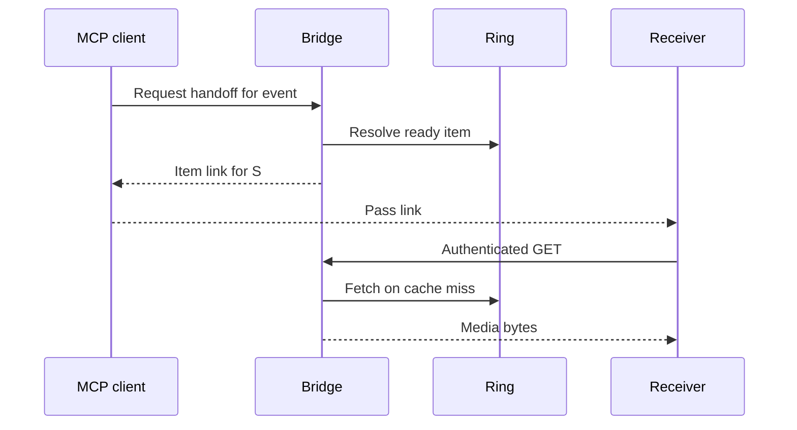
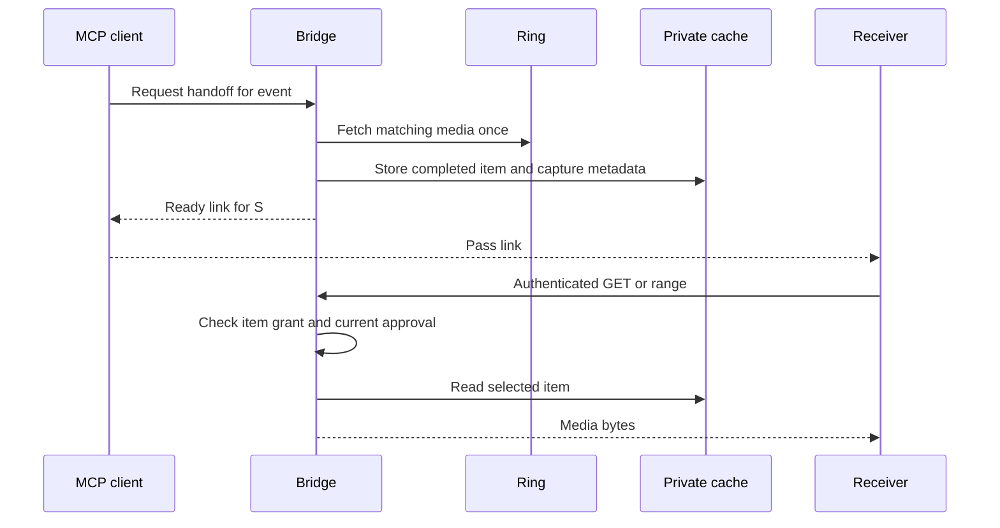
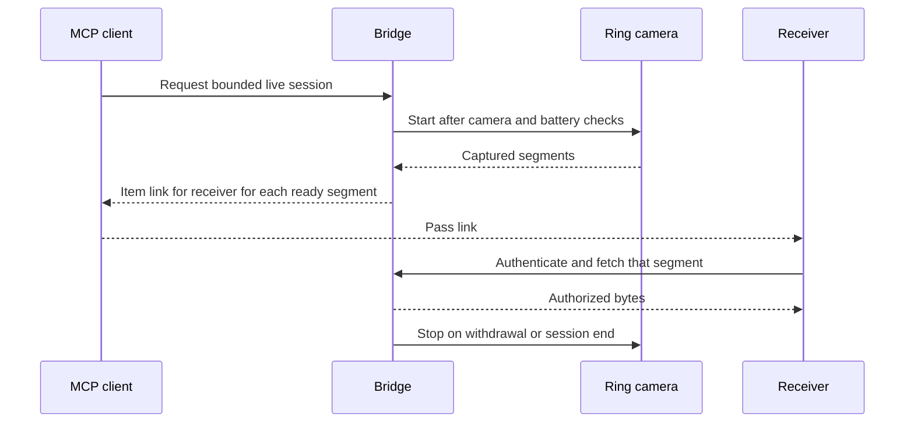

# Design Analysis: Iteration 003

## Problem Framing

Iteration 002 can tell an agent that something happened. Iteration 003 should help it answer three household questions: *What happened? Who should see it? What may I do about it?* A person detection should lead to a photo or clip of that detection, a motion or history query should explain recent activity, and low-battery alerts and the digest should surface devices that need attention. An owner should be able to tune events by household, sensor type and individual camera, and each agent should receive its selected events. An agent asked to arm the alarm or operate a light must show the consequence, obtain the bound one-time confirmation, execute at most once and audit the outcome. Seeing media confers no control authority. [Iteration map](../../plan.md) · [Requirements](../../spec.md)

The camera handoff is the first end-to-end proof. A real doorbell callback reached ChatGPT in 913 ms, and the linked Ring app separately returned a JPEG for a post-link window. Neither proves that a second service can fetch the photo or clip of a particular detection. Test that with a receiver using its own identity; recognition and an Alexa announcement are later consumers. Keep the working home connector for existing sensor and alarm paths while verifying official API capabilities per device. Treat the UI notification timing, health-alert email, seven-day soak, clock comparison and month-end bill as outstanding field checks. [Pilot evidence](../../research.md) · [Carried checks](../002/review.md)

## Key Design Decision Points

1. **Who can receive media? Settled November 22.** One owner approval per household, camera and receiving service covers photos and clips. Every fetch uses the receiver’s own identity and a short-lived grant for one item. This is common to all alternatives.
2. **When does the bridge obtain the bytes?** Fetch from Ring when the receiver opens the link, or stage the requested item before announcing that it is ready. In either case, send the original event immediately. Correlate household, camera, event and capture time. If Ring is still processing, retry the same event. If there is no match, report that outcome. A newer snapshot would answer a different question.
3. **How long does an item grant live?** Choose a lifetime and its starting point. The options below start the clock when an item is ready and the grant is issued. Grant lifetime is separate from the service’s sign-in and the configurable seven-day media cache. A service that misses its window needs a newly authorized handoff.
4. **What should withdrawal do?** All options stop issuing grants when the owner withdraws approval. Decide whether an issued grant remains usable until expiry, whether the next fetch or range request must fail immediately, and whether an active transfer must stop. Media already delivered is outside the bridge’s control.
5. **Does the receiver get live view?** Distinguish a recorded event clip, a finite burst or clip captured for the requesting agent, and a receiver following a camera as events unfold. FR-017 and FR-018 already cover finite capture for the agent. A live handoff would add session start/stop, battery limits and a different withdrawal test. Camera approval alone never starts a live session.
6. **Where do the other iteration features meet this design?** Household settings must distinguish storing an event, pushing it to a given client, allowing media from a camera and approving a receiver. Stored events remain queryable even when push is muted. Shared homes start with camera events dropped, sensor events stored only, and alarm events handled as in an owned home. Motion/history reads and the battery digest use the existing read path. Arm and light operations use their own confirmation and audit path; a timed-out command returns an unknown outcome and is never automatically replayed.

## Alternatives

All three options expose an authenticated bridge URL. A Ring download URL or private Blob address stays behind the bridge. Disabling camera media, denying a service access to another household, and honoring the camera’s sound setting apply to every option. The times below are proposed defaults for the owner to decide. Relative effort compares the receiver path only; it does not estimate the full iteration.

### Option A: Simplest — fetch on first read

**Approach**: Resolve the Ring event to an identifiable media item. When Ring reports it ready, issue a two-minute item grant. On the receiver’s first authenticated GET, the bridge fetches the bytes from Ring and relays them. Fall back to the configured private cache if that same item is already there. Withdrawal blocks new grants; an issued grant can still start a fetch until expiry. A transfer started in time can finish. Receiver scope is recorded event photos and clips.

**Architectural pattern**: Authenticated on-demand proxy with a receiver-bound grant.

**Quality features considered**: Minimal stored state, but receiver availability and Ring availability must overlap. Revalidate upstream download destinations. A provider reference that no longer resolves must fail for that item. Respect the shared Ring limiter on retries.

**Effort estimate**: Lowest. Requires the common approval UI, event lookup, grant issuer and authenticated fetch; no staging job is needed for a first download.

**Reversibility cost**: Low. The bridge can later stage bytes behind the same URL. Changing withdrawal semantics changes the promise made to owners and receivers.

**Trade-offs**: Suitable for a prompt receiver. A second download may hit Ring again, a delayed receiver can miss the short window, and removing a service leaves a residual access window of up to two minutes.



### Option B: Reasonable — stage the requested item and check each fetch

**Approach**: On the agent’s request, copy the matching event photo or clip once to private media storage. Hybrid mode can use private Blob Storage. Return a pending result until the copy and its capture metadata are ready. Issue a five-minute item grant at readiness. On every new GET or range request, check the service identity, grant, current camera setting and current approval. Withdrawal invalidates outstanding grants for future reads. Reapproving the same service must not revive an old grant. A response already authorized can finish. Receiver scope is recorded event photos and clips.

**Architectural pattern**: Private, demand-filled media cache behind an authenticated bridge endpoint. An approval version or equivalent revocation record binds the grant to the approval that issued it.

**Quality features considered**: Concurrent requests for the same item should share one capture. Publish the item only after storage succeeds. The same capture time and bytes can be verified at the test receiver even if Ring becomes unavailable. Enforce retention and delete-now; a grant cannot resurrect a deleted item. Log identifiers and outcomes, never image data or credentials.

**Effort estimate**: Medium. Adds item readiness, deduplicated writes, cleanup and a current-approval lookup to the common work in A.

**Reversibility cost**: Medium. The client-facing link can stay stable, but stored items and their deletion obligations must be honored if storage changes.

**Trade-offs**: Staging adds time before the first download and consumes private storage. It gives a slow or retrying receiver a stable item and makes withdrawing approval effective before the next read. The five-minute default needs validation with a real clip, including range requests.



### Option C: By-the-book — add a bounded live session

**Approach**: Keep B’s staged path and five-minute grants for recorded items. Additionally allow an explicit, agent-requested live session after checking media settings and battery limits. Propose a 30-second session cap for the pilot. Give the receiver a ten-second grant for each completed segment, with no grant for future segments. Recheck approval on reads. Withdrawal also cancels the live producer and active bridge transfers for that approval. Already delivered bytes cannot be recalled.

**Architectural pattern**: Session coordinator plus a private segment store and authenticated media delivery. Ring live capability on the selected device and receiver playback are prerequisites to prove.

**Quality features considered**: Bound battery use, bandwidth and simultaneous sessions. Stop on owner withdrawal, disconnect or timeout. Cover cancellation races and measure how long playback continues from the receiver’s existing buffer.

**Effort estimate**: Highest. Includes B plus session lifecycle, segment authorization, player compatibility and live-device testing.

**Reversibility cost**: High. A receiver built for successive live segments depends on session and cancellation semantics that a recorded-item endpoint cannot supply.

**Trade-offs**: A receiver can follow a visitor after the detection, but the first working event handoff would share capacity with a separate streaming and battery validation effort. The saved-JPEG pilot offers no evidence for that live path.



## Crew Recommendation

**Recommended: Option B.** The visitor scenario needs the frame from the detection, even if the receiver begins a few seconds later or retries. Staging on request lets the receiver verify exactly that item and avoids copying every camera event. Checking current approval gives the owner a concrete effect when they remove a service. A bounded live session answers a separate question and has no pilot evidence yet.

Test the recommendation by withdrawing approval after a grant is issued but before its first fetch, then repeating between two clip range requests. Check that a different service is refused and that a reapproval requires a fresh grant. Measure time from detection to item readiness separately from receiver download time. If Ring cannot supply event-correlated media, report that dependency before treating any receiver design as proven.

## Applicable Lenses

- **requirements-nfr**
  - Addressed: Acceptance requires the receiver to fetch a photo and a clip under one camera approval. Check the capture time against the detection.
- **architecture-core**
  - Addressed: The bridge mediates access between Ring, the requesting MCP client, and the separately authenticated receiver.
- **integration-api**
  - Addressed: The client passes an item URL to the approved service. The receiver presents its own identity when it fetches the item.
- **security-compliance**
  - Addressed: Each grant is scoped to one media item and one receiver. Options A, B and C compare grant lifetime and withdrawal behavior.
- **data-storage**
  - Addressed: The approval belongs to a household, camera, and receiving service. The media item belongs to its source camera and event, regardless of where the bytes are stored.
- **observability-resilience**
  - Addressed: If event media is still being prepared, the client retries the same event. The capture timestamp lets the receiver check which detection it received.
- **devops-operations**
  - Addressed: The pilot can verify the handoff with a separately authenticated test receiver before a recognition service is available.
- **ui-ux**
  - Addressed: Household settings expose one approval per camera and receiving service, covering photos and clips together.
- **component-design**
  - Addressed: The map below assigns detection to the camera, event delivery and authorization to the bridge, orchestration to the client, and retrieval to the receiver.
- **code-implementation**
  - Addressed: Exercise the receiver-facing fetch with its own credentials. Test denial for another identity, an unapproved camera, another item, and an expired grant.

## Co-Design Record

### Component-to-responsibility map

| Component | Responsibility |
| --- | --- |
| Ring camera | Reports the detection and provides the source media. |
| Ring MCP Bridge | Delivers the event to the MCP client, identifies the requested photo or clip, and enforces the owner’s approval when issuing and checking a grant. |
| Household settings | Let the owner approve a receiving service for a specific camera in that household. |
| MCP client | Uses the detection to request a photo or clip and passes the item’s URL to the approved receiver. |
| Approved receiver | Authenticates with its own service identity and uses the short-lived grant to fetch the selected item. |

### Agreed flow

A camera reports a detection. The bridge sends the event to the MCP client. The client requests a photo or clip from that event for the approved receiver and passes the URL to it. The receiver authenticates as itself. The bridge checks that the grant is valid for that receiver and item before serving the media.

### Decision

One owner permission per household, camera, and receiving service covers both photos and video clips. For each fetch, the receiver uses its own service identity and a short-lived grant scoped to the selected item.

**Human-agreed**: yes. On November 22, 2026, the owner replied “Agree” to approving each receiving service once per camera in household settings. When asked whether clips needed separate approval, the owner replied “Yes, a single approve for both Video and photos”. On November 23, 2026, the owner closed the discussion with “move on”.

[Supporting note: Camera media handoff](workshop/integration-api.md)

### Agreed UI/screen layout

**Human-agreed**: yes. On November 23, 2026, the owner replied “yes for the ui” to this household settings screen. The service shown is the pilot test receiver.

```text
Household settings       Household [ Home v ]    Camera [ Front Yard v ]
-----------------------------------------------------------------------
Person-detection events  [ Push v ]     (Push / Store only / Drop)
Camera media             [ On v ]
Clip audio               [ Keep Ring audio v ]

Services allowed to receive photos and clips from this camera
  Test receiver                                      [Remove approval]
  [ Select a registered service v ]                  [Add service]

[Save changes]   [Cancel]
```

The household and camera selectors define which approvals the owner is editing. Saving adds or removes access for the selected service and camera. The same row covers both media types. Event handling is a separate control. Shared-home defaults and per-agent notification filters still apply. Under Option B, saving removal denies subsequent fetches, including range requests, on outstanding grants.

## Human Decision

- **Chosen option**: Option B — stage the requested event media and check current approval on every fetch.
- **Decision verdict**: On November 23, 2026, the owner replied “B” to the three alternatives and “yes for the ui” to the proposed household settings screen.
- **Reason**: The owner selected the recommended option and gave no additional rationale. The design rationale is recorded under Crew Recommendation.
- **Modifications or instructions**: Accept Option B and the screen as presented. Issue five-minute item grants once the requested event photo or clip is ready. Withdrawal denies the next GET or range request; an already authorized transfer may finish. Reapproval requires a new grant. Receiver live view is outside this handoff.
