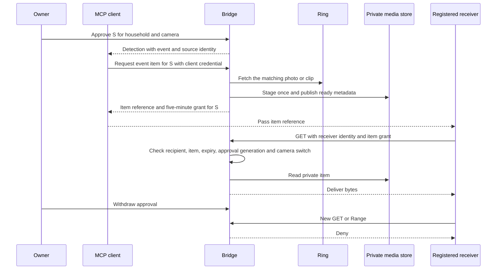

# Iteration 003 review diagrams

## Event media handoff

The original event is independent of item readiness. The client retries a pending request for the same event. A later reapproval creates a new generation; an issued grant cannot regain access. [Design](design-analysis.md)
